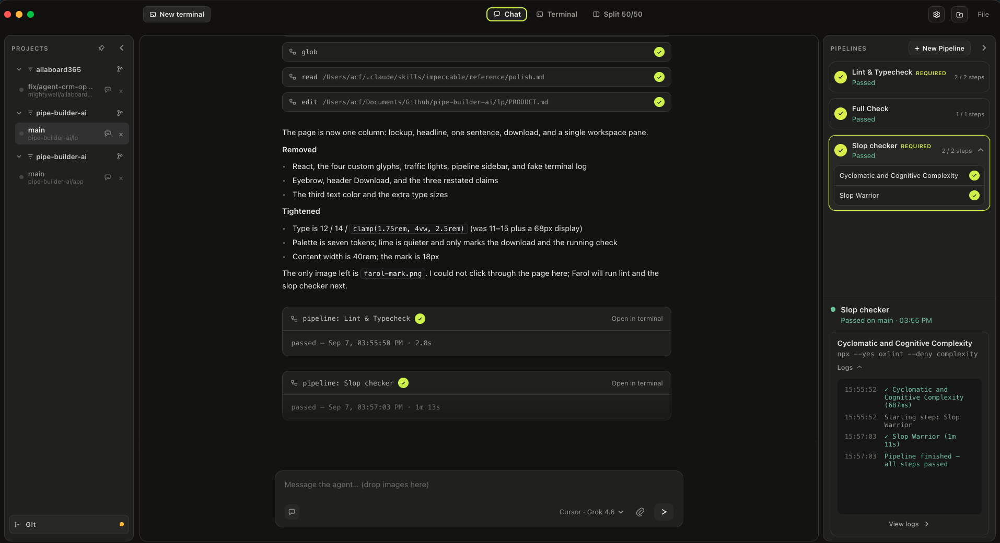
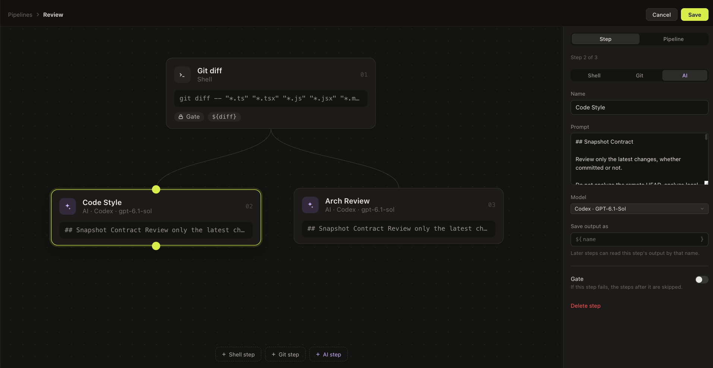
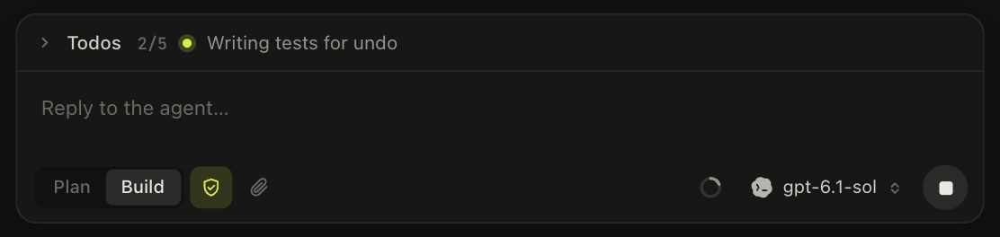

<p align="center">
  
</p>

<h1 align="center">Farol</h1>

<p align="center">
  <strong>The anti-slop workspace for your agents.</strong><br />
  Checks and balances so they don&rsquo;t go wild. Lint, tests, and review on the branch.<br />
  Failures go back to the agent to fix, before that code is yours.
</p>

<p align="center">
  <a href="https://github.com/acf77/farol/releases/latest/download/Farol-mac-arm64.dmg"><strong>Download for Mac</strong></a>
  &nbsp;·&nbsp;
  <a href="https://github.com/acf77/farol/releases">Releases</a>
  &nbsp;·&nbsp;
  <a href="#quick-start">Quick start</a>
  &nbsp;·&nbsp;
  <a href="app/README.md">Build from source</a>
</p>

<p align="center"><sub>Apple Silicon only. Works with Claude, Codex, Cursor, OpenCode, OMP, and models through OpenRouter.</sub></p>

<br />



## How it works

1. **You describe the task.** Open a Git checkout and write the task in Chat. Plan first, or go straight to Build.
2. **The agent works on the branch.** It runs through its own CLI, like Claude Code or Codex, in your project folder.
3. **Farol runs the checks.** When the agent finishes a change, Farol runs your pipelines on the checkout, uncommitted work included. Shell steps run your linter and tests. AI steps review what a script can&rsquo;t.
4. **Failures go back to the agent.** A failed step sends its report to Chat. The agent fixes it, and the checks run again until every one passes.

The code only becomes yours once it&rsquo;s green.

## Pipelines run your scripts. And AI.

A pipeline is a list of checks on your agent&rsquo;s branch. Next to your linter and test suite, add AI steps: a prompt that reviews the architecture, audits security, or flags slop, on the agent and model you pick.

- **Shell steps** run your own commands, in your own login shell.
- **Git steps** hand a diff, log, or file list to the steps after them.
- **AI steps** run a prompt on their own agent and model, and pass or fail with a verdict.
- **Gates** skip the rest of the pipeline when a step fails, so a broken build doesn&rsquo;t waste a review.
- **Mandatory in Chat** runs a pipeline after every change the agent makes. **Before commit** and **Before push** run it as a Git hook.

Build them on a canvas: drag steps, wire them in order, and pass one step&rsquo;s output to the next with `${name}`.



Pipelines are saved in `.farol/pipelines.json`, so you can commit them and the whole team gets the same checks.

## Chat that keeps the agent honest



- **Plan, then Build.** Plan mode reads and asks questions without touching files. Select **Execute plan** when you like the plan.
- **Pick any agent per chat.** Switch agent and model from the message box. Add fallbacks for when one hits a usage limit.
- **Stay in the loop.** Mention files with `@`, run skills with `/`, answer the agent&rsquo;s questions inline, and watch its todo list as it works.
- **Approve tools, or don&rsquo;t.** Let tools run on their own, or have the agent ask before it edits files or runs commands.
- **Long tasks stay sharp.** The context meter shows how full the session is. **Fresh start** continues in a new session from the agent&rsquo;s own handoff note.
- **One chat per branch.** Worktrees sit side by side in the project rail, so two agents can work on two branches at once.

## Quick start

1. **Install Farol.** [Download the Mac build](https://github.com/acf77/farol/releases/latest/download/Farol-mac-arm64.dmg), open the `.dmg`, and drag Farol into Applications. The build isn&rsquo;t notarized yet, so macOS blocks it the first time. Try to open it once, then go to System Settings › Privacy & Security and select **Open Anyway**. On macOS 14 and earlier, right-clicking the app and choosing **Open** also works.
2. **Install an agent CLI** and sign in once:

   | Agent | Install |
   | --- | --- |
   | Claude | `npm i -g @anthropic-ai/claude-code` |
   | Codex | `npm i -g @openai/codex` |
   | OpenCode | `brew install opencode` |
   | Cursor | `curl https://cursor.com/install -fsS \| bash` |
   | OMP | `npm i -g omp-cli` |
   | OpenRouter | An API key in Settings, run through OpenCode or [pi](https://github.com/badlogic/pi-mono) |

3. **Pick your agents.** On first launch, Farol finds the CLIs you have installed. Choose a default and select **Open Farol**.
4. **Open a project** with <kbd>⌘O</kbd>. A new project starts with a few starter pipelines you can edit.
5. **Give the agent a task** in Chat, and watch the checks run.
6. **Ship it.** Open **Source Control** from the project rail to commit, push, and open or merge a pull request.

## Where your code goes

Shell steps run on your Mac. AI steps send their prompt and the code they need to the model provider you picked, through that provider&rsquo;s own CLI and login. Checks apply to the agents Farol runs in Chat. An agent you start yourself in a terminal can use Farol&rsquo;s pipeline tools over MCP, but Farol doesn&rsquo;t enforce them there.

## Build from source

```bash
git clone https://github.com/acf77/farol.git
cd farol/app
npm install
npm run dev
```

See [`app/README.md`](app/README.md) for packaging, tests, and how the app is put together.

## Repository

| Path | What&rsquo;s there |
| --- | --- |
| [`app/`](app) | The Electron desktop app |
| [`app/service/`](app/service) | The run service for remote pipelines |
| [`docs/adr/`](docs/adr) | Architecture decisions |
| [`CONTEXT.md`](CONTEXT.md) | The product&rsquo;s vocabulary |
| [`DESIGN.md`](DESIGN.md) | How Farol should look, feel, and read |

Questions, bugs, or ideas: use **Help › Send Feedback** in the app, or [open an issue](https://github.com/acf77/farol/issues/new/choose). Want to help? Read [`CONTRIBUTING.md`](CONTRIBUTING.md).

## License

[MIT](LICENSE)
