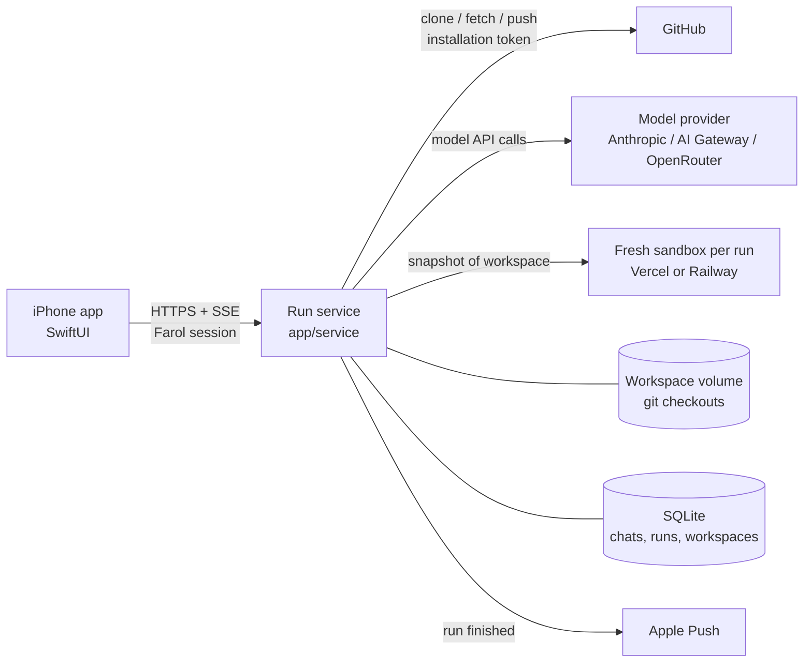

# Farol for iPhone: implementation plan

Status: proposal · 2026-10-16

## 1. Goal and scope

An iPhone app where a signed-in developer can:

1. **Create a workspace from a Git repo**: pick a GitHub repo and branch.
2. **Chat with an AI** about that workspace, in Plan or Build mode.
3. **Run the workspace's remote pipelines** and watch them live.
4. **Close the loop**: when a pipeline fails, the AI reads the failure, fixes the code, and runs the pipelines again until they pass or it runs out of attempts. Then the user can commit, push, or open a PR.

Out of scope for v1: CLI sessions (Claude Code, Codex, Cursor, OpenCode, OMP), terminal panes, running anything on the user's laptop, the code editor, and Android. Android is a second native client later, generated from the same API contract (§4, D1).

Decided:
- **Mobile is for paid users only.** The service checks the plan on every hosted-workspace and chat endpoint and answers `402` otherwise. Model calls are paid by the service and included in the plan, with per-user spend caps.
- **Only remote pipelines run from mobile.** Only `target: "remote"` pipelines are listed.
- **Hosted workspaces show up on the desktop** (§4, D6).

## 2. What exists today, and what a phone is missing

| Capability | Where it lives today | Usable from a phone? |
| --- | --- | --- |
| Pipeline model and DAG rules | `app/shared/types.ts`, `app/shared/graph.ts` | **Yes.** Pure TypeScript, no Node or Electron imports |
| Run result contract | `app/shared/run-result.ts` (schema 1) | **Yes** |
| Failure report the agent reads | `app/shared/failure.ts` | **Yes** (pure) |
| Questions, todos, handoff, mandatory pipelines, context meter | `app/shared/questions.ts`, `todos.ts`, `agent-context.ts`, `mandatory.ts` | **Yes** (pure) |
| Run service: sandboxed shell steps, SSE, cancel | `app/service` (ADR 0004, 0005) | **Yes.** Built for web and mobile clients |
| GitHub sign-in for mobile (auth code + PKCE) | `app/service/auth.ts`, `POST /v1/auth/code` (ADR 0006) | **Yes.** Already designed for mobile |
| Chat agent and its validation/repair loop | `app/electron/agent-controller.ts` (1.6k lines) | **No.** It spawns local CLIs and talks to them through control lines |
| The checkout the AI edits and the snapshot it uploads | The local disk, plus `electron/checkout-snapshot.ts` | **No.** A phone has no checkout |
| Git: commit, push, PR | `electron/git.ts`, the `git` and `gh` CLIs | **No** |
| UI | `app/src` (React DOM, xterm, CodeMirror) | Logic partly reusable, components not |

**The main gap.** On desktop, the AI, the files, and Git all live on the laptop, and only shell steps go to the sandbox. On a phone, all three have to move to the server. Everything else (run service, auth, pipeline format, failure report, run-result contract) is already there.

## 3. Target architecture

The phone is a thin client. The service gains three things:

1. **Hosted workspaces.** A Git checkout of a repo and branch on the service's disk. The agent's file edits land there. When a pipeline runs, the service snapshots that checkout with the same rules as `checkout-snapshot.ts` and starts the run through the existing `executePipeline` path. The sandbox stays the only place repo code runs.
2. **A hosted agent.** A server-side port of the agent-controller cycle that calls a model API directly instead of spawning a CLI. Its tools are file operations on the workspace plus Farol actions (run pipelines, ask questions, update todos, Git actions).
3. **Persistence.** Chats, workspaces, and run history are stored, so the app can be killed and reopened, and the service can restart without losing chat history.

### The safety rule we keep

ADR 0006 makes the sandbox the security boundary. The hosted agent keeps that rule: **the service never executes repository code**. Agent tools only read and write files on the workspace volume. Anything that executes (tests, builds, installs) is a pipeline step, so it runs in a fresh sandbox. Git operations on the volume run with hooks and filters off (`core.hooksPath=/dev/null`, no LFS smudge, `protocol.allow` restricted), so a cloned repo cannot run code on the host.

## 4. Key decisions (each one gets an ADR)

### D1. Mobile stack: native SwiftUI, with a thin client and a generated API contract

The client is thin by design. The agent loop, failure report, mandatory pipelines, and Git rules all run on the service (D2, D3). What the phone needs is the API types, an SSE reader, and rendering for markdown, ANSI, and diagrams. So sharing TypeScript logic, the main argument for React Native, buys little. AI-assisted development also makes a second native client (Kotlin/Compose for Android) cheap.

- **Native fits the product.** `PRODUCT.md`'s first principle is "Borrow the platform". SwiftUI gives system materials, SF fonts, Dynamic Type, VoiceOver, haptics, and the Keychain directly.
- **Better at the hard mobile parts.** `ASWebAuthenticationSession` for PKCE, `URLSession` streaming for SSE (`bytes(for:)`), APNs, background refresh, and Live Activities for a running pipeline (a natural fit for "watch CI on the lock screen").
- **Stack:** Swift 6, SwiftUI, iOS 17+ (`@Observable`), SwiftData for an offline cache of chats and runs, `swift-markdown-ui` for markdown, `WKWebView` with a bundled `mermaid.min.js` for diagrams, and a small Swift port of `src/ansi.ts` (about 470 lines, pure) producing `AttributedString`.
- **The contract stays single-source.** Service request, response, and event types are defined once in TypeScript (`shared/run-result.ts` plus new `shared/api/*.ts`), exported as an **OpenAPI 3.1 + JSON Schema** document, and turned into Swift with `swift-openapi-generator` (Kotlin later from the same file). CI fails if the generated client is out of date. This replaces "share the TS module" and keeps the client from drifting.
- **The rule that keeps it cheap:** no business logic on the client. If a rule exists on desktop (stale results, mandatory pipelines, repair attempts), the service applies it and sends the outcome. The phone renders it.

Costs, stated plainly: Android becomes a second client rather than a build target. Someone on the team must be able to review Swift, because AI-written code still needs a reviewer who knows the platform. Builds need macOS (Xcode Cloud or a macOS CI runner).

Rejected: **Expo / React Native**, whose main gain (reusing `app/shared` on the client) mostly disappears with a thin client, at the cost of a less native feel and a bridge layer for auth, push, and Live Activities. **A PWA or a web-view wrapper of `app/src`**, which is built around Electron IPC and desktop layout.

Repo change: add `ios/` (Xcode project, Swift package for the generated API client) next to `app/`, plus `app/shared/api/` and an `openapi:generate` script.

### D2. The AI runs on the service through a model API, with structured tools instead of control lines

Managed Chat uses hidden lines (`FAROL_PIPELINES`, `FAROL_QUESTIONS`, `FAROL_GIT`, `FAROL_TODOS`, `FAROL_HANDOFF`) because Farol cannot add tools to a CLI. On the service Farol owns the harness, so the same contract becomes typed tools:

| Desktop control line | Hosted agent tool |
| --- | --- |
| `FAROL_PIPELINES: [...]` | `run_pipelines({ ids })`, which ends the turn |
| `FAROL_QUESTIONS: [...]` | `ask_user({ questions })`, which parks the turn |
| `FAROL_GIT: {...}` | `git_commit`, `git_push`, `git_create_pr` |
| `FAROL_TODOS: [...]` | `set_todos({ todos })` |
| `FAROL_HANDOFF:` | Not needed in v1. The service owns the full history; trimming reuses `agent-context.ts` budgets |
| `FINISHED_PLAN` | `finish_plan({ plan })` |

File tools: `list_dir`, `read_file` (ranged), `glob`, `grep`, `write_file`, `edit_file` (exact replace), `delete_file`. All of them are confined to the workspace root through `shared/rel-path.ts`, and secret-looking paths are refused using the same rule as the snapshot. Plan mode exposes only the read tools, which gives a real review gate rather than a prompt-only one.

Implementation: Vercel AI SDK (`ai`, already a dependency) with the Anthropic provider as the default and AI Gateway or OpenRouter as alternatives. That keeps model choice open, mirrors the desktop's provider list, and gives tool calling plus streaming in one loop.

The **validation/repair cycle** is ported from `agent-controller.ts`, not rewritten:

1. User message → the agent turn (tools) → `run_pipelines(ids)`. Mandatory pipelines are merged in with `shared/mandatory.ts`.
2. The service runs the selected remote pipelines on a fresh snapshot of the workspace.
3. All pass: the cycle completes ("Validated").
4. Any fail: build the report with `shared/failure.ts` and send the repair opening ("Farol validation attempt N failed…"), wrapping the output as untrusted text. Go back to step 1, up to `DEFAULT_MAX_ATTEMPTS = 5`.
5. Cancel works at any point and stops the active sandbox.

The decision logic (attempt counting, `selectedPipelines`, `parsePipelineIds` → tool args, mandatory handling, the repair prompt) should be **extracted from `agent-controller.ts` into `shared/agent-cycle.ts`**, so the desktop and the service run the same loop and the desktop gains tests for it.

### D3. Workspaces are server-side Git checkouts, created from GitHub through a GitHub App

- The service already signs users in with GitHub but drops the token (ADR 0006: "storing GitHub tokens: not needed until the service fetches repositories itself"). It now fetches repositories, so this decision changes.
- Recommended: the **Farol GitHub App** is installed on the repos a user wants. The service mints short-lived **installation tokens** (from the App's private key) to clone, fetch, push, and open PRs. No long-lived user token is stored.
- To check that a user may use a repo, read the user's own access at sign-in: during the PKCE exchange, call `GET /user/installations` and `/user/installations/:id/repositories`, cache the result, and re-check on workspace creation with the user-to-server token. Store that token encrypted with an 8-hour expiry and refresh token only if this check needs it after sign-in.
- Layout: one bare mirror per repo (`/data/repos/<owner>/<repo>.git`), one worktree per workspace (`/data/ws/<id>`) on a working branch `farol/<slug>` created from the chosen base branch. This reuses the worktree ideas in `shared/worktree.ts`.
- Pipelines come from the workspace's own `.farol/pipelines.json`. ADR 0005's rule is unchanged: you can only run what the repo ships. Only `target: "remote"` pipelines are listed, and only they can be passed to `run_pipelines`. A remote pipeline with an AI step is shown but disabled, with the reason "AI steps run on the desktop app." If a mandatory pipeline isn't remote, the agent is told it can't be validated from mobile, and the cycle reports that rather than claiming a pass.

### D4. Persistence: SQLite on the service's volume

Tables: `users`, `workspaces`, `chats`, `messages` (role, parts JSON, tool calls), `runs` (RunResult JSON, sha256), `run_events` (for replay), `push_tokens`. Keep the JSON key and user files as they are, or migrate them later. A restart still cancels in-flight runs (ADR 0005), but it marks them `cancelled` with a reason instead of losing them, and chats survive.

Note: the service is Node + esbuild today (`service:build`). `app/CLAUDE.md` asks for Bun. Choose one runtime for the service before adding a database: `bun:sqlite` under Bun, or `better-sqlite3`/`node:sqlite` under Node 22.

### D5. Long work runs on the server; the phone watches

iOS suspends a backgrounded app and drops its connections. Everything long-running (agent turns, runs, repair cycles) lives on the service. The phone:

- reads chats and runs over SSE with `Last-Event-ID` replay, which the service already does for runs and now does for chats;
- gets an **APNs push** when a cycle ends ("CI passed after 2 repairs", "Needs your answer", "Failed after 5 attempts");
- can show a running cycle as a **Live Activity** (APNs updates).

### D6. Hosted workspaces show up on the desktop

The working branch `farol/<slug>` is the handoff, so this mostly comes through Git.

- The desktop signs in to the same service, which it already does for remote pipelines. A **Hosted workspaces** section in the project rail lists the user's workspaces for repos that are open locally.
- **Open on this Mac:** fetch `farol/<slug>`, then open it as a worktree using the existing `git.worktree` flow. The chat transcript opens read-only, with an option to **continue in local Chat**, which seeds a new managed chat with the hosted chat's task and latest requests, the same shape as a **Fresh start**.
- **Both sides edit the same branch.** The service fetches before each agent turn and before each push. A non-fast-forward push is refused and reported ("The branch moved on GitHub: Sync first"), never forced. **Sync** merges the remote branch in and reports conflicts. It doesn't resolve them.
- **Run results stay honest:** each result carries the snapshot `sha256` and branch head, so the desktop labels a hosted run stale once the branch moves.

## 5. Service API additions

Everything is under the existing bearer-session auth and owner checks.

| Method and path | Purpose |
| --- | --- |
| `GET /v1/github/repos` | Repos the user can use through the App (paged, searchable) |
| `GET /v1/github/repos/:owner/:repo/branches` | Branch picker |
| `POST /v1/hosted-workspaces` | `{ repo, baseBranch, name? }` → clone/fetch, create a worktree on `farol/<slug>` |
| `GET /v1/hosted-workspaces` · `GET …/:id` · `DELETE …/:id` | List, detail (branch, ahead/behind, dirty files, pipelines), remove |
| `POST …/:id/sync` | Fetch the base and merge it in (refuses on conflict and reports the paths) |
| `GET …/:id/files?path=` · `GET …/:id/file?path=` | Read-only browsing |
| `GET …/:id/diff` | Working-tree diff vs base, for the Changes view |
| `POST …/:id/runs` | Run a pipeline on a snapshot of the workspace. Returns the existing `RunResult` and run events |
| `POST …/:id/chats` · `GET …/:id/chats` | Create and list chats |
| `POST /v1/chats/:id/messages` | `{ text, mode, model }` starts or continues a cycle |
| `GET /v1/chats/:id/events` | SSE: assistant deltas, tool activity, pipeline cards, questions, todos, status, usage |
| `POST /v1/chats/:id/answer` · `POST /v1/chats/:id/cancel` | Answer questions, stop a cycle |
| `POST …/:id/git/commit` · `/push` · `/pr` | User-initiated Git actions (the agent uses the same code paths), gated by `gitHooks` pipelines as in ADR 0001 |
| `POST /v1/devices` | Register an APNs token |

The existing `/v1/runs` and `/v1/workspaces` (desktop) endpoints stay unchanged.

## 6. iPhone app: screens

1. **Sign in.** "Sign in with GitHub" (PKCE through `ASWebAuthenticationSession`, redirect `farol://auth`, which must be added to `FAROL_AUTH_REDIRECTS`). The session goes in the Keychain. A user without a paid plan sees "Farol mobile is part of the paid plan" and nothing else: no price and no purchase link (see the App Store risk in §9). Then a prompt to install the GitHub App on repos, if none are accessible.
2. **Workspaces.** A list showing repo, branch, last cycle status, and dirty count. **New workspace** opens repo search → base branch → create.
3. **Workspace** (tabs):
   - **Chat** (default): streamed messages, tool activity rows ("Edited `src/x.ts`"), pipeline cards with per-step pass/fail/skip glyphs and expandable ANSI output, question cards with options plus free text, Mermaid diagrams, the todo list, a Plan/Build switch, a model picker, the context meter, and Stop.
   - **Pipelines**: the repo's pipelines, a Run button, and a live log (status shown by glyph and text, never by color alone, per PRODUCT.md).
   - **Runs**: history scoped to branch and snapshot hash. Results from an older snapshot are labeled stale.
   - **Changes**: changed files, a read-only diff, a commit message (with **Generate with AI**), Commit, Push, and Create PR (hold to confirm, as on desktop).
4. **Settings.** Account, default model, plan name and usage against the spend cap (read-only, no purchase flow), sign out.

Design: follow `app/DESIGN.md` tokens and adapt them to iOS (SF Pro / SF Mono, system materials, Dynamic Type, Reduce Motion), WCAG AA as in `PRODUCT.md`.

## 7. Phased delivery

Each phase ends with something usable on TestFlight.

### Phase 0: Groundwork (~1 week)
- Define the API types in `app/shared/api/`, generate OpenAPI, and set up `swift-openapi-generator`. Scaffold `ios/` (SwiftUI app, generated client package, SwiftLint, XCTest) with a macOS CI job.
- Choose the service runtime (D4) and add SQLite with migrations. Add a paid-plan check middleware (`402` for non-paid users on mobile endpoints).
- Extract `shared/agent-cycle.ts` from `agent-controller.ts` with tests, keeping desktop behavior identical (`agent-controller.test.ts` must stay green).
- ADRs: 0008 hosted workspaces and the GitHub App, 0009 hosted agent, 0010 mobile client.

### Phase 1: Sign in, workspaces, remote pipelines (~2–3 weeks)
- Service: GitHub App installation tokens, repo and branch listing, hosted workspaces (mirror + worktree, hardened git config), `…/:id/runs` reusing `executePipeline` with a snapshot built from the worktree.
- App: sign in, workspace list and create, pipelines tab, live run log (SSE through `URLSession.bytes`, resuming with `Last-Event-ID`), runs history.
- **Milestone:** from an iPhone, create a workspace from a private repo and run its CI pipeline remotely.

### Phase 2: Chat with a hosted agent (~3–4 weeks)
- Service: agent loop with the AI SDK, file tools, Plan/Build, `ask_user`, `set_todos`, chat persistence and SSE, per-user model-spend limits.
- App: Chat tab (streaming, tool rows, questions, diagrams, todos, model picker, Stop).
- **Milestone:** "Add a `--json` flag to the CLI" in Build mode produces edits on the workspace branch, visible in Changes.

### Phase 3: Auto-repair loop and Git (~2 weeks)
- Service: `run_pipelines` drives the ported validation/repair cycle (mandatory pipelines, failure report, up to 5 attempts). Git commit/push/PR through installation tokens, gated by `gitHooks` pipelines.
- App: pipeline cards inside chat turns, "Repairing (attempt 2/5)" status, Changes tab with commit, push, and PR.
- **Milestone:** break a test, ask the AI to fix it; it runs CI remotely, reads the failure, fixes the code, re-runs to green, and opens a PR, all from the phone.

### Phase 4: Desktop handoff (~1–2 weeks)
- Desktop: a Hosted workspaces list, **Open on this Mac** (fetch + worktree), a read-only hosted chat with **continue in local Chat**, and stale labeling of hosted runs.
- Service: fetch-before-turn, non-fast-forward refusal, Sync.
- **Milestone:** start a fix on the phone, then open the same branch and chat context on the Mac.

### Phase 5: Mobile polish and release (~2 weeks)
- APNs on cycle and run end, a Live Activity for a running cycle, background-safe reconnects, a SwiftData offline cache, haptics, iPad layout, a VoiceOver and Dynamic Type pass.
- Usage screen, rate limits, abuse controls.
- TestFlight → App Store review.

Rough total: **11–14 weeks for one developer**, or about 7–8 weeks with one person on the service and desktop and one on the iOS app from Phase 1.

## 8. Testing

- **Service:** vitest units for the agent cycle (scripted fake model, deterministic tool calls), workspace git ops against local bare repos, path confinement and secret refusal, owner isolation, SSE replay.
- **Integration:** a fake sandbox provider (the receipt-mode pattern) so the full loop "edit → run → fail → repair → pass" runs in CI without Vercel.
- **App:** XCTest for view models, the SSE parser, and the ANSI port (reusing `src/ansi.test.ts` cases as fixtures); XCUITest flows on the simulator against a stub server for sign-in, creating a workspace, running a pipeline, and answering a question.
- **Contract:** CI regenerates the OpenAPI document and the Swift client, and fails on a diff.
- **Desktop regression:** the extracted `agent-cycle` must keep `agent-controller.test.ts` passing unchanged.

## 9. Risks and mitigations

| Risk | Mitigation |
| --- | --- |
| The hosted agent can't run commands to explore (Claude Code can) | Clear tool contract: execution goes through pipelines. Later, add an `exec_in_sandbox` tool for read-only commands in a throwaway sandbox |
| Slow runs because every sandbox installs dependencies | Operator-built Railway checkpoints (`RAILWAY_CHECKPOINT`); later, a per-repo dependency cache keyed by lockfile hash, built by trusted setup and never by a run (ADR 0006) |
| Prompt injection through pipeline output or repo files | Wrap output as untrusted data (the README already requires this). Agent tools have no network and no secrets. Pushes only go to `farol/*` branches; merging stays a human action |
| Model cost on the operator's bill | Per-user spend caps and plan limits (existing `402` path); show the context meter and usage in the app |
| Storing GitHub credentials | Installation tokens minted per operation. Any user token stays encrypted, short-lived, and revocable through the existing `sessionsValidAfter` |
| Service restart mid-cycle | Persisted chat and run state; the cycle is marked interrupted with a **Resume** action instead of silently disappearing |
| App Store: GitHub-only sign-in (guideline 4.8) | It's a GitHub client, which the exemption covers; prepare the review note. Fallback: add Sign in with Apple linked to a GitHub identity |
| App Store: paid-only access without in-app purchase (guideline 3.1) | Ship as a free companion to the paid web service (3.1.3(f)): no purchasing inside the app and no call to action to buy elsewhere. Unpaid users see a neutral notice. Provide a paid review account. Check the current rules for link-outs (they differ by storefront) before release |
| Client and service drift with a native client | One OpenAPI contract, generated Swift client, CI diff check, no business logic on the client |
| Phone and desktop both changing `farol/<slug>` | Fetch before each turn and push; never force-push; Sync reports conflicts instead of resolving them |
| Workspace disk growth | Shared bare mirrors, idle workspace eviction (keep the branch on GitHub, delete the worktree), per-user quotas |

## 10. Open questions for you

Resolved: mobile is paid-only, model calls are paid by the service; only remote pipelines; hosted workspaces show up on the desktop; native SwiftUI.

Still open:
1. **Where does billing live?** The desktop reads plans and `402` from the service (`electron/billing.ts`), but this repo's `app/service` has no billing routes. The paid-plan check needs a source of truth. Is there a separate hosted service the mobile API should extend?
2. **Spend cap per paid user** for hosted-agent model calls, and what happens at the cap: block, or fall back to a cheaper model?
3. **Default model** for the hosted agent, and whether to let users pick per chat (proposed: yes, same picker as desktop).
4. **Swift review.** Who on the team reviews the iOS code?
